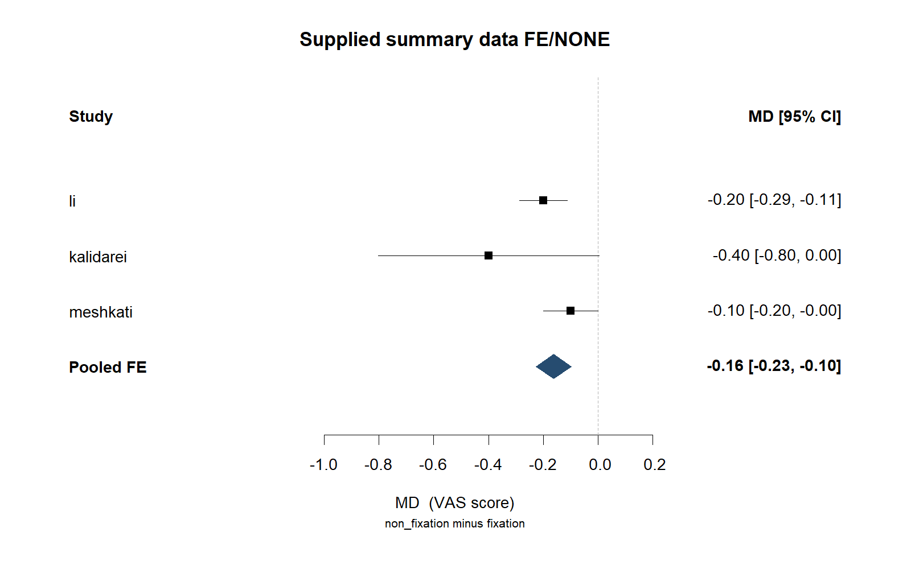
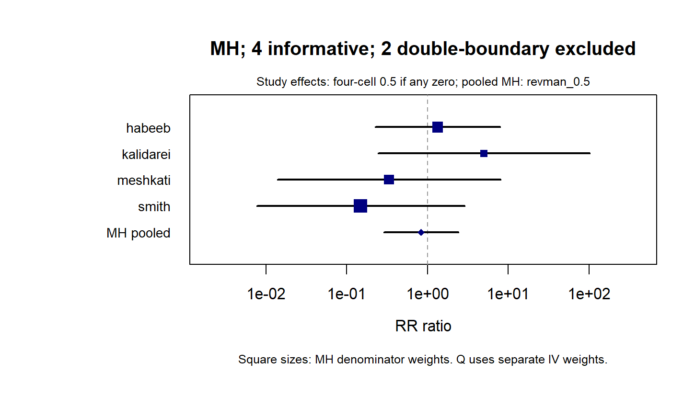
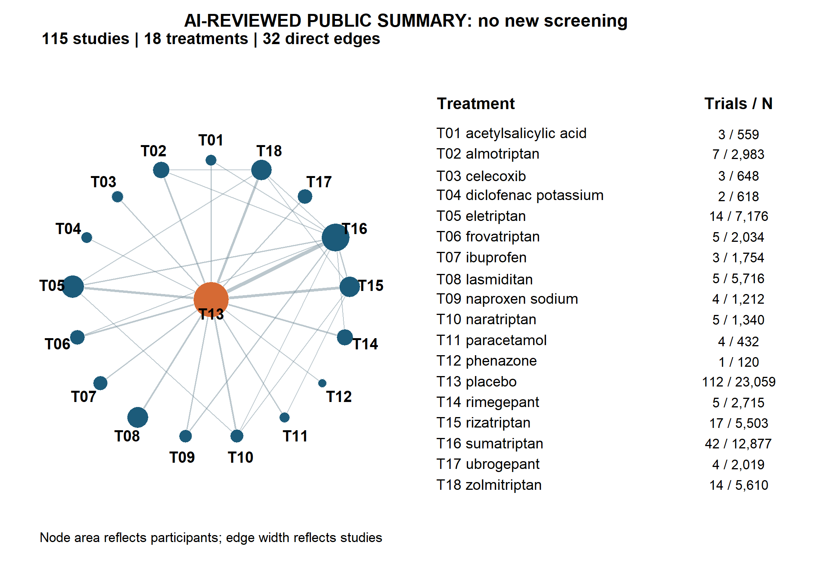
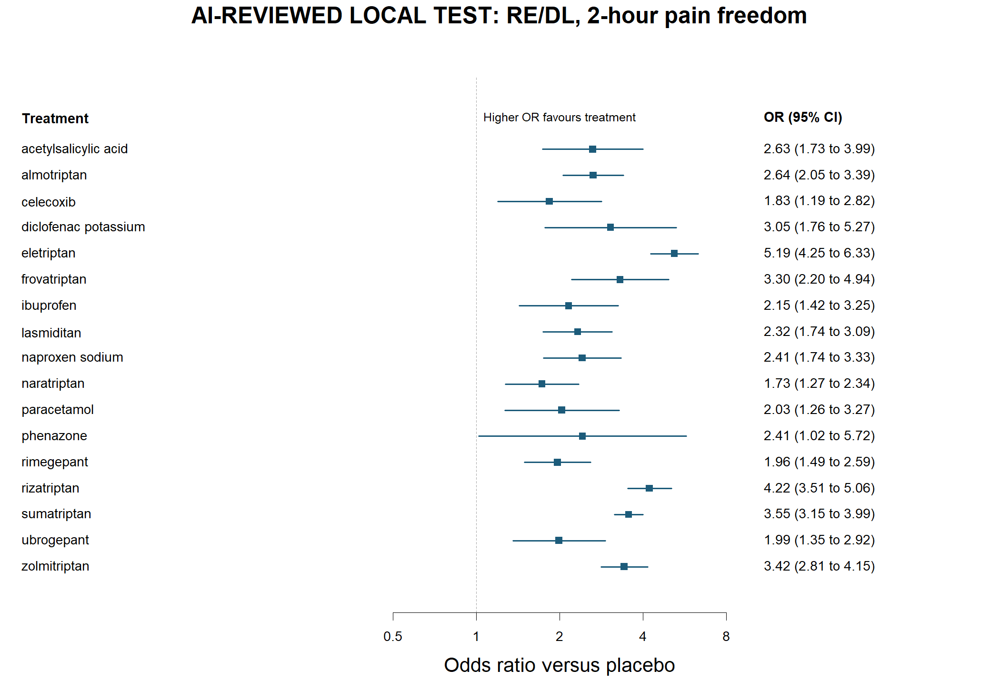

# 安装到你的 Agent

适用于 **Windows x64**，由能读写本地文件并执行命令的 Agent 使用。

把下面一句复制给 Agent：

> 请从 https://github.com/Nzjye1/ye1-meta-analysis 获取 Ye1 Meta，先读 SKILL.md 和 INSTALL.md，准备官方依赖并完成环境自检，然后告诉我如何开始。

> 我想做一项 Meta 分析，请从这个仓库获取 Ye1 Meta 并按包内说明准备环境和自检，再帮我明确研究问题、PICO、结局及需要提供的材料：https://github.com/Nzjye1/ye1-meta-analysis 。

> 我已有方案、题录或研究级汇总数据，请从这个仓库获取 Ye1 Meta、读说明并检查运行环境，带我选择合适路线、确认配置并开始分析：https://github.com/Nzjye1/ye1-meta-analysis 。

## Ye1 Meta｜系统综述与 Meta 分析 Skill

**让 Agent 串起文献、数据、分析和写作，免费使用。**

可以从一个研究想法开始，也可以接着已有题录、合法全文或研究级汇总数据继续做，输出分析表图、证据资料和可编辑英文 Word 草稿。

## 下载与开始

- [Windows 安装 ZIP：首次联网准备官方依赖](https://github.com/Nzjye1/ye1-meta-analysis/raw/refs/heads/main/downloads/Ye1-Meta-Online-Candidate-20261031-r-version-fix.zip)
- [ZIP 的 SHA256](downloads/SHA256SUMS.txt)
- [获取本仓库源码](https://github.com/Nzjye1/ye1-meta-analysis/archive/refs/heads/main.zip)
- [安装与使用说明](INSTALL.md) · [Agent 指令](SKILL.md)

安装 ZIP 已包含 Skill、源码与安装脚本；首次使用从固定官方来源取得 Python、R 和依赖。标准安装下载约 **277 MB**，需要结构化 PDF 解析时可按需追加 Docling 和本地模型。详细命令放在 [INSTALL.md](INSTALL.md)，交给 Agent 按本机环境执行即可。

## 从已有材料继续

| 你的起点 | Ye1 帮你推进 |
|---|---|
| 有研究想法 | PICO、方案、检索记录，再接筛选、全文整理和分析 |
| 有题录或合法全文 | 导入、去重候选、筛选与分歧记录、页表定位和数值复核 |
| 有研究级汇总数据 | 核对字段与方法，生成统计结果、图表、事实报告和 Word |
| 有结果或草稿 | 按同一版本的事实与引用修订，保留旧结果和修改依据 |

文献流程支持 PubMed / Europe PMC 检索及 RIS / CSV 导入；全文优先使用许可允许的 XML / HTML，也可使用你提供的 PDF。缺全文时按清单补充后继续，候选数值有来源定位和逐值复核。

## 八类分析路线

| 路线 | 典型任务 | 教程 |
|---|---|---|
| 两两 Meta | RR、OR、HR、MD、SMD，固定或随机效应、森林图 | [两两流程](app/CUSTOMER-WORKFLOW.md) |
| 稀有事件 | Mantel–Haenszel / Peto，记录零事件与校正设置 | [稀有事件](app/RARE-EVENT.md) |
| 相关效应 | 同研究多效应与明确的相关结构 | [相关效应](app/DEPENDENT-PROJECT.md) |
| 频率学网络 Meta | 连通网络、多臂相关性、治疗比较和不一致性检查 | [网络 Meta](app/NETWORK-PROJECT.md) |
| 诊断试验 Meta | 四格表、敏感度、特异度和 SROC | [诊断](app/DIAGNOSTIC-PROJECT.md) |
| 多阈值诊断 Meta | 按阈值组织数据及对应诊断模型 | [多阈值](app/MULTITHRESHOLD-PROJECT.md) |
| 剂量反应 | RR 尺度的线性或样条分析 | [剂量反应](app/DOSE-PROJECT.md) |
| 单组 Meta | 单组比例、人时发生率 | [单组](app/SINGLE-PROJECT.md) |

按数据和方法条件可组织亚组、Meta 回归、预测区间、影响分析、敏感性分析和小研究效应诊断，并整理适用的 RoB、SoF、PRISMA 资料、英文 IMRaD 草稿及事实绑定修订。

## 公开汇总数据案例

### PLOS ONE 2024：五个结局

从作者已整理的研究级汇总数据进入分析，覆盖疼痛、恢复正常活动时间、复发、感染和血清肿；在选定 FE / DL 与 MH–RevMan 兼容配置下，估计值和 95% CI 与论文显示精度相符，形成森林图、事实报告与 Word。[论文与资料来源](https://doi.org/10.1371/journal.pone.0314334)

**六个月疼痛｜固定效应 MD 森林图。** 来自 PLOS ONE 公开汇总数据的 FE/NONE 复现输出，点击查看原图。

**复发｜MH／RevMan 兼容 RR 森林图。** 使用 `revman_0.5` 配置，保留零事件处理与排除信息。

[更多 PLOS 结果图与敏感性图](assets/cases/MORE-RESULTS.md)

### BMJ 2024 偏头痛：2 小时无痛

使用作者公开汇总数据中的 115 项研究、18 个治疗节点，以频率学随机效应 DL 配置生成网络图、森林图、153 个治疗对的比较表与 Word；相应参照效应、网络比较及已导出局部/全局指标按作者显示精度对照。REML 配置单独保留。[论文与资料来源](https://doi.org/10.1136/bmj-2024-080107)

**治疗网络图｜同一次 RE/DL 案例输出。** 115 项研究、18 个治疗节点、32 条直接比较连线；节点面积对应参与者数，线宽对应研究数。

**相对安慰剂的森林图｜随机效应 DL。** 展示各治疗的 OR 和 95% CI，较高 OR 对应更多 2 小时无痛。

两个案例均以作者汇总数据为起点，展示统计分析、来源绑定表图与报告流程。图片保留原数值与标签。[图片来源与原文件索引](assets/cases/README.md)

## 联系与许可

微信：**`ye1aikeyan`** · 邮箱：[ye1aikeyan@163.com](mailto:ye1aikeyan@163.com) · [GitHub Issues](https://github.com/Nzjye1/ye1-meta-analysis/issues)

自有代码采用 [MIT](LICENSE)；依赖与模型保留 [各自原许可](THIRD-PARTY.md)。[隐私说明](PRIVACY.md) · [能力与数据条件](CAPABILITIES.md)
