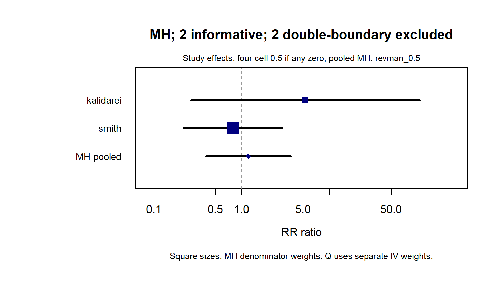
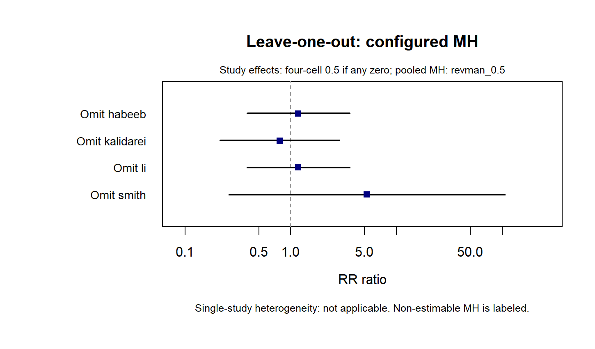
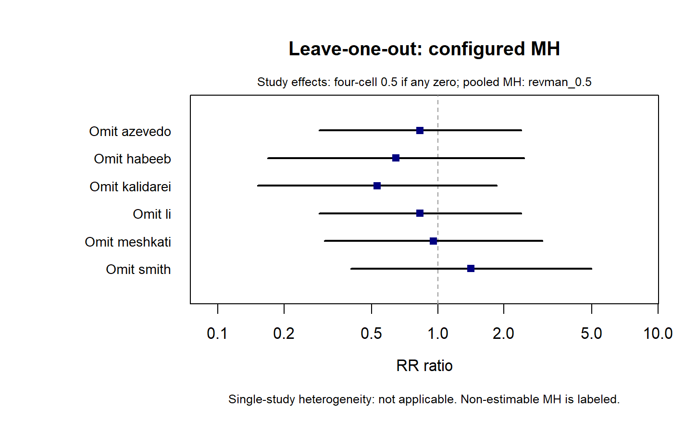
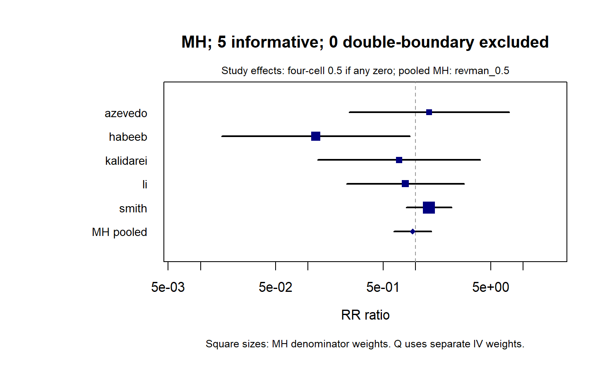
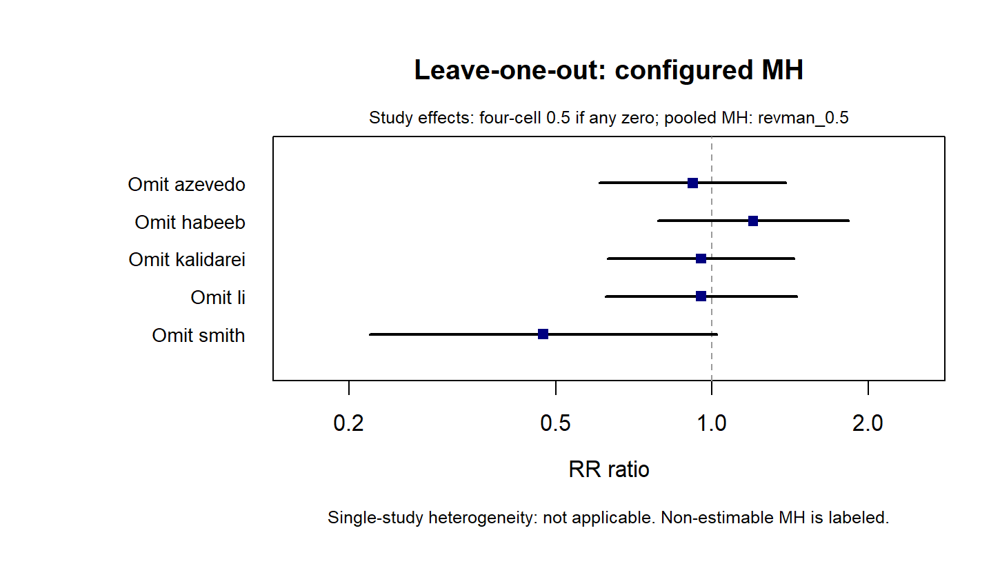
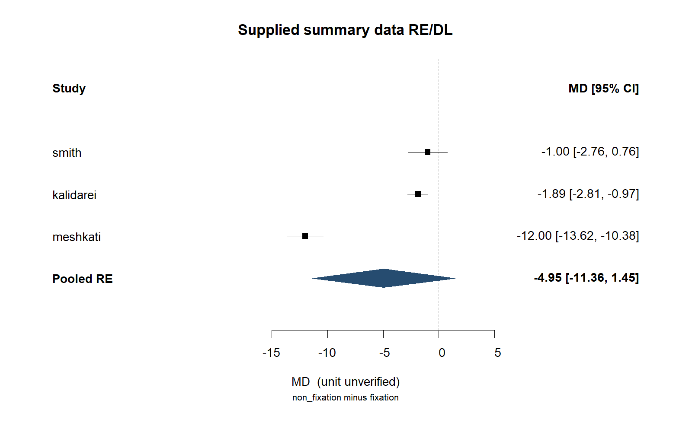

# 更多 PLOS ONE 2024 结果图

[返回首页案例](../../README.md#公开汇总数据案例) · [图片来源与哈希](README.md)

基于作者公开汇总数据的既有复现图：[论文 DOI](https://doi.org/10.1371/journal.pone.0314334)。保留原图字节，点击查看大图。

## 感染｜MH，revman_0.5，RR 森林图

## 感染｜MH，revman_0.5，逐一剔除敏感性图

## 复发｜MH，revman_0.5，逐一剔除敏感性图

## 血清肿｜MH，revman_0.5，RR 森林图

## 血清肿｜MH，revman_0.5，逐一剔除敏感性图

## 恢复正常活动时间｜RE/DL，MD 森林图

